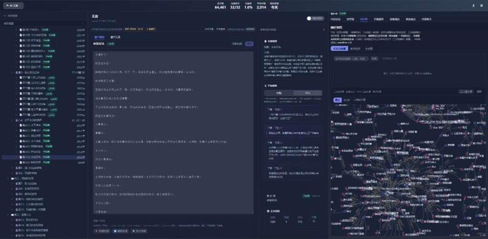
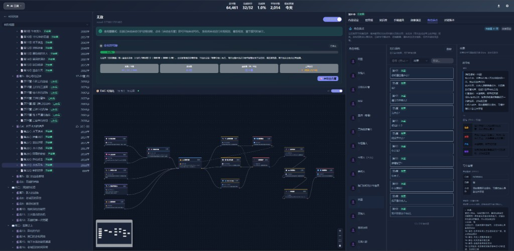

# PlotPilot（墨枢）— 开源剧情引擎内核与开放叙事模组生态

> 剧情引擎内核准备重启，欢迎贡献者踊跃加入~

<p align="center">
  
</p>

<p align="center">
  <strong>开源剧情引擎内核 · 开放叙事模组生态（Mod Hub） · 省额度多角色模型网关</strong>
</p>

<p align="center">
  面向长篇小说、剧本与严肃叙事生产的基础设施：持久记忆 · 知识图谱 · 自动推进流水线 · 质量治理闭环 · <code>plotpilot-mod/v1.1</code> 模组协议
</p>

<p align="center">
  <a href="https://www.python.org/"></a>
  <a href="https://vuejs.org/"></a>
  <a href="https://fastapi.tiangolo.com/"></a>
  <a href="#plotpilot-modv11-开放叙事模组协议规范"></a>
  <a href="https://tauri.app/"></a>
  <a href="https://github.com/shenminglinyi/PlotPilot/releases"></a>
  <a href="https://github.com/shenminglinyi/PlotPilot/stargazers"></a>
  <a href="LICENSE"></a>
</p>

> 本次架构升级完整亮点、改动思路与逐模块技术设计说明见 [`UPGRADE_HIGHLIGHTS_AND_ARCHITECTURE.md`](UPGRADE_HIGHLIGHTS_AND_ARCHITECTURE.md)。

---

<p align="center">
  
  
</p>

---

## 这是什么

PlotPilot（墨枢）是一个面向长篇小说、剧本与严肃叙事生产的**开源剧情引擎内核（Narrative Engine Kernel）与开放叙事模组生态**，不是聊天式写作助手，也不是一组零散的提示词模板。

大多数 AI 写作工具解决的是“生成一段文字”的问题。PlotPilot 解决的是一个更难的系统工程与创作审美问题：

> **如何让 AI 系统在数十万字的叙事跨度里，维持人物一致性、因果链完整性、伏笔闭合率，并在消除廉价“AI 腔”、强化人物潜台词与商业连载审稿留存的前提下，实现低门槛开局与高水准长篇推进？**

这不是单一提示词调优问题，而是**状态机工程、开放模组协议与多角色算力路由问题**。PlotPilot 的答案是：

- **在底层**：构建完整的剧情状态管理基础设施（Story Bible、章级摘要链、事件流、故事线 DAG、伏笔账本与向量检索），配合公开标准 OAuth 授权、本机订阅网关自动嗅探与 `main / cheap / kg` 三角色省额智能分流；
- **在上层**：通过向后兼容的 `plotpilot-mod/v1.1` 开放协议，将文风滤镜、潜台词刀法、毒点审稿官、首章节拍支架、审稿红线与去套话词表解耦为可自由安装、真字 A/B 试写盲测、叠加回滚与去中心化分享的**叙事模组（Narrative Mod Pack）**。

项目边界很明确：

- **不是** 单轮续写器：核心目标是长篇连续生产与章节质量治理，而不是回答一次孤立的写作请求。
- **不是** 大上下文堆料：世界观、人物、伏笔、故事线会被结构化为可追踪状态，按场次动态装配。
- **不是** 封闭黑盒应用：官方工作台通过版本化 REST API 与内核交互；全量 78 个内置内核提示词接点向创作者完全敞开，支持通过模组中心一键挂载或导出分享，同时完整保留并增强 `plotpilot.xyz` 官方云广场连接能力。

---

## 核心升级亮点总览

### 1. 墨枢模组中心（Mod Hub）与 `plotpilot-mod/v1.1` 全栈流派协议

墨枢模组中心（路由 `/square` 及工作台内嵌面板，核心实现位于 `frontend/src/views/SquareView.vue` 与 `frontend/src/components/workbench/PromptPlaza.vue`）采用**官方云广场（`plotpilot.xyz`）+ 去中心化开源仓库（GitHub / HTTPS JSON / 本地文件）**双轨融合架构：

| 视图标签 | 核心定位与能力说明 |
|----------|--------------------|
| **发现** | 一站式浏览内置精选模组、`plotpilot.xyz` 官方书元、社区共享模组与全网热榜风向，支持按六大创作职能筛选、查看样章与 **300 字真字 A/B 试写盲测** |
| **已安装** | 集中检视当前已启用的模组清单、被接管的内核节点明细，支持单模组或单节点粒度的一键无损卸载与基线回滚 |
| **内置内核** | 直接检视与精细调优引擎内置 CPMS 全部 **78 个内置内核节点**，支持历史版本管理、JSON 导出/导入备份与新建自定义节点 |
| **反 AI 质检** | 集成 `AntiAIDashboard`，集中检视去 AI 味规则集、陈词滥调拦截与章节质量治理状态 |

模组中心按长篇写作与审稿痛点划分为六大职能分区（`style-anti-ai` 文风与去AI味、`opening-hook` 题材开局包、`pacing-plot` 剧情节拍器、`dialogue-voice` 人物声线与潜台词、`review-guard` 毒点审稿官、`worldbuilding` 世界观营造），随库内置 6 款开箱即用精选模组（`frontend/src/domain/modPack/curatedPacks.ts`），并内置可视化**创作者模组打包工坊**（`ModPackBuilderModal.vue`）。

### 2. 模组详情「300 字零落库真字 A/B 试写演武场」

点开任意模组详情（`ModPackDetailModal.vue` -> `POST /api/v1/llm-control/mods/sandbox-ab-trial`），创作者无需先安装模组或污染在写书稿，即可选择当前书目上下文或输入自定义引子，实时并发生成**「未挂模组原系统基线」vs「挂载该模组后」的 300 字真实正文对照**：

- **零写库沙箱隔离（`mod_sandbox_trial_service.py`）**：全程在内存态临时组装提示词覆盖并调用模型，对 SQLite 业务表、章节表与 CPMS 节点表零写入；
- **对抗级凭证脱敏擦除（`mod_sandbox_routes.py`）**：内置线性时间多层解码（URL / Base64 / Hex / JSON 反转义）凭证擦除器，彻底阻断上游异常回显泄露 API Key 或 Bearer Token。

### 3. 免填 Key 公开标准 OAuth + 本机订阅网关嗅探 + 省额度三角色分流

面向不想手动管理繁琐 API Key 或希望最大化复用现有订阅额度的创作者，AI 控制台（`LLMControlPanel.vue`、`EngineMatrixSection.vue`）新增完整的连接与省额路由体系：

- **公开标准 OAuth 免密授权（`llm_oauth_service.py` + `oauth_credential_store.py`）**：原生支持 **OpenRouter OAuth PKCE**、**GitHub Models RFC 8628 Device Flow** 与 **Google Gemini 公开标准 OAuth PKCE**。所有刷新令牌与访问凭证独立存储于服务端本机 `data/oauth_credentials.json`（权限 `0600`），前端与快照导出全程零明文暴露；
- **本机订阅网关与 CLI 一键嗅探（`local_gateway_probe.py` + `loopback_transport.py`）**：自动探测本机回环订阅代理网关（如 `Magpie` `127.0.0.1:3425/v1` 等 OpenAI 兼容端点）及本机 CLI 工具就绪状态，支持一键导入可用模型列表；回环直连传输层严格禁止代理劫持与跨主机重定向；
- **省额度三角色智能分流（`provider_factory.py` + `trace_context.py`）**：支持将 **主笔正文（`main`）**、**大纲/审校轻量任务（`cheap`）** 与 **知识图谱/记忆抽取（`kg`）** 独立绑定到不同档位模型（例如旗舰模型写正文、高性价比 Flash 模型跑后台抽取与校验），在不牺牲正文质感的前提下显著降低长篇连载 Token 消耗。

### 4. 三分钟极速冷启动立卷向导 + `Alt+Z` 专注模式页边轻批注

- **三分钟极速开书向导（`ColdStartWizardModal.vue` + 后端幂等建书）**：首页一键唤起三步极速开局——第 1 步嗅探本机网关并锁定省额黄金编组，第 2 步选定市场题材并挂载流派模组，第 3 步自动注入模组的 `openingBeatTemplate` 首章节拍支架并立卷直入首章试写。底层由跨标签页 `Web Locks` 双层锁与 SQLite `BEGIN IMMEDIATE` 原子幂等建书（`create_if_absent` / `init_setup_variables_if_absent`）守护，断网重连或重复点击绝不产生幽灵重复书目或覆盖用户定制设定；
- **`Alt+Z` 沉浸专注模式与宣纸页边朱批（`Workbench.vue` + `ZenMarginAnnotations.vue`）**：工作台按 `Alt+Z` 一键收拢左右辅助栏，居中展开 `820px` 宣纸写作区与 `58ch` 黄金行宽；右上角可呼出不抢输入焦点的**页边轻批注**抽屉，按线性时间实时扫描当前手稿命中的模组 `antiAiWordlist`（高频 AI 套话）与 `reviewRedlines`（商业连载毒点红线），点击批注卡片即可平滑滚动定位到对应正文段落。

### 5. 宣纸松烟编辑室视觉重构与多端工程硬化

- **东方纸墨三主题体系**：内置宣纸深黛（亮色）、纯黑松烟（暗色）、古籍泥金（黑金）三套高对比度主题（正文对比度 `>= 4.5:1`），衬线与无衬线排印分级清晰，窄屏（`<768px`）自动切换顶栏模态抽屉，零横向溢出；
- **多标签页 Web Locks WAL + SQLite 原子 CAS + 逐跳 IP 钉扎 SSRF 防护**：前后端协同防止多窗口并发改写提示词冲突，远程拉取 GitHub/HTTPS 模组清单强制公网 IP 钉扎与 TLS 原始字节流响应头守卫，免疫 DNS Rebinding。

---

## `plotpilot-mod/v1.1` 开放叙事模组协议规范

`plotpilot-mod/v1.1` 在 100% 向后兼容 `plotpilot-mod/v1` 清单导入的基础上，新增了面向开篇立卷、审稿护栏与模型选型的四项可选流派扩展字段（核心实现位于 `frontend/src/domain/modPack/types.ts` 与 `frontend/src/domain/modPack/modProtocol.ts`）。

### 标准清单结构（`PlotPilotModManifest`）

```json
{
  "schema": "plotpilot-mod/v1.1",
  "exportedAt": "2026-11-14T08:00:00.000Z",
  "pack": {
    "id": "mod-cold-realism-anti-ai",
    "name": "冷峻纪实 · 深度去 AI 味滤镜",
    "glyph": "纪",
    "author": "作者署名",
    "repoOrOrigin": "github:owner/repo",
    "trustLevel": "local",
    "roleCategory": "style-anti-ai",
    "roleLabel": "文风滤镜",
    "summary": "以具象器物动作与生理冷感替代空泛心理总结，根治排比升华与五官套话",
    "version": "v1.1.0",
    "license": "MIT",
    "updatedAt": "2026-11-14",
    "usageLabel": "本地构建",
    "replacesBuiltin": true,
    "tags": ["去AI味", "冷峻叙事"],
    "recommendedModelTier": "flagship",
    "openingBeatTemplate": "【首章起笔节拍】开篇落于具体器物与感官错位，前 500 字内亮出人物当前处境与利益死结……",
    "reviewRedlines": [
      "严禁在章末使用排比句或哲学升华总结人物命运",
      "严禁未铺垫知情渠道便让配角直接猜中主角底牌"
    ],
    "antiAiWordlist": ["嘴角勾起", "眼中闪过一丝", "心中五味杂陈"],
    "readmeSections": [{ "heading": "核心说明", "body": "..." }],
    "showcase": {
      "scenario": "测试场景",
      "beforeExcerpt": "未启用时的默认片段",
      "afterExcerpt": "启用模组后的实测片段"
    },
    "overrides": [
      {
        "nodeKey": "chapter-generation-main",
        "nodeLabel": "主工作流章节生成",
        "mode": "append_protocol",
        "systemContent": "【模组协议正文】..."
      }
    ]
  }
}
```

### 三种节点挂载模式与 Fail-Closed 拓扑保护

| 模式名称 | 适用场景 | 协议行为与无损回滚机制 |
|----------|----------|------------------------|
| `append_protocol` | **无损协议追加（推荐默认）** | 在目标节点原 System 提示词末尾挂载独立协议块，100% 保留原有 `{context}`、`{outline}` 等模板变量插槽与 Pydantic 结构化输出契约；支持多个模组在同一节点按序叠加、各自独立卸载 |
| `replace_system` | **基线快照替换** | 安装前自动校验全文协议拓扑，捕获纯净原始 System 基线（`baselineSystem`）并保留其他已装模组的追加层；卸载时字节级还原安装前基线与块外手动编辑 |
| `standalone_node` | **加密归属独立节点** | 作为独立自定义节点安装进本地库，基于浏览器 CSPRNG 生成 128-bit 随机归属令牌（32 位小写十六进制 `originToken`）写入协议头，严格区分模组自建节点与用户同名手建节点 |

协议引擎采用有限状态单遍扫描器解析节点正文中的 `<!-- [PlotPilot-Mod:<packId>:START:...] -->` 边界注释标记，严禁模组正文内嵌受保护标记字面量；一旦检测到嵌套、交叉或残缺标记立即 Fail-Closed 终止改写并完整保留用户现场。

---

## 内核架构

PlotPilot 内核由五个相互协作的子系统构成：

### 1. 叙事状态机（Narrative State Machine）

引擎在任意时刻都持有完整的叙事快照，包含：

- **Story Bible**：人物档案（含 POV 防火墙、登场频率调度）、地点图、世界设定三元组
- **章级摘要链**：每章生成后自动提炼的压缩摘要，构成跨章上下文骨架
- **叙事事件流**：关键事件的时序登记表，支持因果链追溯
- **故事线 DAG**：多故事线的有向无环图，可视化分支与汇合点
- **伏笔注册表**：钩子（Hook）的开启、悬置、消费状态完整追踪

任何一次章节生成，引擎都会从上述快照中动态装配上下文窗口，而非依赖模型自身的“记忆”。

### 2. 向量语义检索层（Vector Retrieval Layer）

引擎维护两条并行索引：

- **章内容索引**：基于 FAISS / ChromaDB 的本地向量库，对所有已写章节做语义切片索引
- **三元组索引**：从正文中自动抽取的 `(主体, 关系, 客体)` 三元组，支持结构化与语义混合查询

生成时，引擎通过当前场景语义自动召回相关历史内容，注入上下文，消除“模型失忆”问题。嵌入服务支持 OpenAI 兼容 API（轻量）、本地 `sentence-transformers` 模型（离线高性能）以及免额外向量密钥的本地检索兜底。

### 3. 剧情引擎运行时（Engine Runtime）

生产入口收敛在 `engine/runtime/engine_daemon.py`：由 `EngineDaemon` 承接守护进程生命周期，委托 `StoryPipelineRunner` 运行章节规划、写作、审计与状态推进；章节写作默认走 `BaseStoryPipeline` 十步管线。

```
宏观规划（部 / 卷 / 幕结构）
    └─▶ 幕级节拍规划（Beat Sheet 生成）
            └─▶ 章节生成循环
                    ├─▶ 叙事治理预算
                    ├─▶ 章节执行剧本准备
                    ├─▶ 上下文装配（人物 / 世界观 / 记忆 / 伏笔）
                    ├─▶ 按角色路由 LLM 调用（main / cheap / kg）
                    ├─▶ 内容策略验证
                    ├─▶ 文风漂移检测
                    ├─▶ 章末管线（摘要 / 事件 / 三元组 / 伏笔）
                    ├─▶ 向量索引更新
                    ├─▶ 张力评分
                    └─▶ 状态落库 → 继续 / 重写 / 暂停
```

关键工程特性：
- **单一生产入口**：`scripts/start_daemon.py` 构造依赖并启动 `EngineDaemon`
- **可回退写作路径**：默认 `StoryPipeline` 写作，`PLOTPILOT_USE_STORY_PIPELINE=off/legacy` 可临时回退
- **熔断保护**：连续失败超过阈值自动暂停，附带诊断信息
- **单写者路由（Write Dispatch）+ 事务级原子 CAS**：SQLite 写操作经统一调度器与 `BEGIN IMMEDIATE` 原子前置校验执行，消除并发写冲突
- **SSE 实时推流**：生成进度、Token 消耗、当前阶段、错误信息全部通过 Server-Sent Events 实时推送到前端
- **检查点快照**：阶段推进前自动存档，支持从任意检查点恢复

### 4. 提示词策略层（Prompt Strategy Layer）

引擎暴露 **20+ 独立提示接点**（内置 CPMS 完整包含 78 个可调优内核节点），每个接点均可通过 `prompt_packages/` 下的 YAML 配置文件或墨枢模组中心的 `plotpilot-mod/v1.1` 模组包独立覆写：

| 接点类型 | 包含接点 |
|----------|----------|
| 规划类 | `planning-main-plot-suggest` · `planning-quick-macro` |
| 生成类 | `scene-director` · `chapter-narrative-sync` · `chapter-generation-main` |
| 知识类 | `bible-all` · `bible-characters` · `bible-locations` · `bible-worldbuilding` |
| 分析类 | `style-analysis` · `tension-analysis-diagnosis` |

### 5. 质量监控子系统（Quality Monitor）

引擎内置叙事质量的量化监控，不依赖人工逐章审阅：

- **张力心电图**：每章生成后计算张力评分（0–10），历史曲线持久化，低谷自动触发诊断
- **文风相似度检测**：基于向量余弦相似度计算当前章节与风格基准的偏离程度
- **漂移告警 + 定向修写**：偏离超过阈值时，引擎不回滚章节，而是触发定向修写任务，保留已有进度
- **陈词滥调扫描 + 页边实时巡检**：后端规则库/语义检测与工作台 `Alt+Z` 页边轻批注联动，实时标记高频套路表达与审稿红线

---

## 内核与生态

```
PlotPilot 内核（本仓库）
        │
        ├── 叙事状态机 + 幂等建书立卷守卫
        ├── 向量语义检索层
        ├── 剧情引擎运行时 + 三角色算力智能路由（main / cheap / kg）
        ├── 提示词策略层（20+ 核心接点 / 78 个内置 CPMS 节点）
        ├── 公开标准 OAuth + 本机订阅网关嗅探器
        └── 质量监控子系统 + 零落库 A/B 试写沙箱
                │
                ▼
        REST API（FastAPI · v1 · 版本化 + 原子 CAS + SSRF 守卫 + 凭证脱敏）
                │
        ┌───────┴──────────────────────┐
        │                              │
  官方工作台前端               生态扩展层（基于内核与 plotpilot-mod/v1.1）
  Vue 3.5 · TypeScript         ├── 墨枢模组中心（云广场 + GitHub 双轨生态）
  宣纸松烟 UI · Alt+Z 朱批     ├── 垂直领域工具（剧本/游戏剧情/IP 衍生……）
  Tauri 桌面客户端              ├── 第三方前端 / 编辑器插件
                                ├── 自定义提示词包与 GitHub 开源模组
                                └── 云服务 / SaaS（需遵守许可证）
```

### 云广场连接与隐私数据契约（可选）

内核内置一个**云连接器**（`/api/v1/cloud/*`），可登录 [plotpilot.xyz](https://plotpilot.xyz) 官方文墨广场，浏览官方书元、社区共享模组、全网热榜以及进行妙/批注/追更/收飞鸽通知互动——把本地创作接到云端社区。数据边界是显式契约：

- **上云仅限**：会话凭证、广场目录拉取（官方书元/社区共享/热榜）、广场互动（妙/批注/追更/通知）、风格包落笔事件的最小元数据（书名）
- **永不上云**：作品手稿、章节、知识图谱、人物设定、生成配置、OAuth 模型令牌、引擎状态——内核断云完全可用
- 会话凭证（`data/cloud-session.json`）与模型 OAuth 凭证（`data/oauth_credentials.json`）均仅存内核服务端本地文件（权限 `0600`），浏览器/前端全程零明文凭证；连接器路由仅接受本机回环客户端
- 代理路径白名单 = 广场目录 + 社区 + 社交接口，无通配转发（SSRF 免疫）

默认端点 `https://plotpilot.xyz`，可用 `PLOTPILOT_CLOUD_BASE_URL` 覆盖（自建兼容服务端时）。

---

## 技术选型说明

| 层 | 技术 | 选型理由 |
|----|------|----------|
| 后端框架 | FastAPI + uvicorn | 原生异步 + 自动 OpenAPI 文档，SSE 支持开箱即用 |
| 架构范式 | DDD 分层 + 独立 `engine/` 运行内核 | 领域逻辑、用例编排、生产写作管线与技术实现分离，架构边界单测持续守门 |
| AI 接入与网关 | OpenAI 兼容 / Anthropic Claude / Google Gemini / 火山方舟 + 公开 OAuth PKCE/Device Flow + 本机网关嗅探 | 统一接口抽象，支持免填 Key 授权、本机订阅代理接入与 `main/cheap/kg` 按角色省额路由 |
| 向量存储 | ChromaDB（默认）/ FAISS | 本地部署，零外部依赖，冷启动快 |
| 嵌入模型 | OpenAI 兼容 API / 本地 `bge-small-zh-v1.5` | 在线轻量与离线高性能双模式 |
| 主数据库 | SQLite + Write Dispatch 单写者路由 + `BEGIN IMMEDIATE` 原子 CAS | 嵌入式零依赖，并发写冲突、幂等立卷与多标签页抢占由事务级 CAS 解决 |
| 前端 | Vue 3.5 + TypeScript + Vite + Naive UI + ECharts | 组件类型安全，宣纸松烟视觉系统，知识图谱与 DAG 可视化由 ECharts 驱动 |
| 桌面客户端 | Tauri（Rust） | 比 Electron 内存占用低 80%+，原生系统集成 |

---

## 快速开始

### 方式一：一键启动（Windows，无需安装 Python）

1. 将 `python-3.14.5-embed-amd64.zip` 放入 `tools/` 目录（仅首次）
2. 双击 `tools/plotpilot.bat`

启动器自动完成：环境自检 → 创建虚拟环境 → 安装依赖（自动切换国内镜像源）→ 启动服务 → 打开浏览器。启动后可直接点击首页**「三分钟极速开书」**自动嗅探本机网关或配置模型开局。

> 支持 `tools\plotpilot.bat pack` 打包整个项目分享给他人，对方双击即用。当前启动器固定使用 Python 3.14 系列；如需使用系统 Python，可设置 `PLOTPILOT_PYTHON_EXE` 指向 Python 3.14 的 `python.exe`。

### 方式二：桌面安装版（Windows · Tauri）

前往 [GitHub Releases](https://github.com/shenminglinyi/PlotPilot/releases) 下载最新安装包，内含冻结后端，无需单独安装 Python。

构建流程见 [docs/BUILD_INSTALLER.md](docs/BUILD_INSTALLER.md)。

---

## 开发者文档

**环境要求**：Python 3.14.x、Node.js 18+

```bash
# 后端 — Windows
py -3.14 -m venv .venv && .venv\Scripts\activate
pip install -r requirements.txt
copy .env.example .env    # 可填写 LLM 凭证，或在启动后通过 Web 控制台 OAuth / 本机网关嗅探接入
uvicorn interfaces.main:app --host 127.0.0.1 --port 8005 --reload
```

```bash
# 后端 — Linux / macOS
python3.14 -m venv .venv && source .venv/bin/activate
pip install -r requirements.txt
cp .env.example .env
uvicorn interfaces.main:app --host 127.0.0.1 --port 8005 --reload
```

```bash
# 前端（另开终端）
cd frontend && npm install && npm run dev
```

| 地址 | 说明 |
|------|------|
| `http://127.0.0.1:8005` | 后端 API（若已构建 `frontend/dist`，可直接访问完整 Web 工作台） |
| `http://127.0.0.1:8005/docs` | OpenAPI 交互文档 |
| `http://localhost:3000` | 前端开发服务器 |

---

## 环境变量

| 变量 | 说明 |
|------|------|
| `LLM_PROVIDER` | 可选；指定默认 LLM 提供方 |
| `ANTHROPIC_API_KEY` / `ARK_API_KEY` / `OPENAI_API_KEY` / `GEMINI_API_KEY` | 可选；环境变量凭证（也可直接在前端 AI 控制台使用 OAuth 或本机网关接入） |
| `ARK_BASE_URL` / `ARK_MODEL`、`ANTHROPIC_BASE_URL` / `ANTHROPIC_MODEL`、`OPENAI_BASE_URL` / `OPENAI_MODEL`、`GEMINI_BASE_URL` / `GEMINI_MODEL` | 对应提供方的接口地址与模型名 |
| `PLOTPILOT_OAUTH_GOOGLE_CLIENT_ID` / `PLOTPILOT_OAUTH_GITHUB_CLIENT_ID` | 可选；配置公开标准 OAuth 客户端 ID 以启用对应平台免密授权 |
| `EMBEDDING_SERVICE` | `openai`（`.env.example` 默认）或 `local`（需额外安装模型，见 `requirements-local.txt`） |
| `EMBEDDING_API_KEY` / `EMBEDDING_BASE_URL` / `EMBEDDING_MODEL` | 云端嵌入服务配置；`EMBEDDING_API_KEY` 为空时可回退读取 `OPENAI_API_KEY` |
| `EMBEDDING_MODEL_PATH` / `EMBEDDING_USE_GPU` | 本地嵌入模型路径与 GPU 开关 |
| `VECTOR_STORE_ENABLED` / `VECTOR_STORE_TYPE` / `VECTOR_STORE_PATH` | 向量索引开关、类型与持久化目录 |
| `CORS_ORIGINS` | 生产环境前端域名，逗号分隔 |
| `DISABLE_AUTO_DAEMON` | 设为 `1` 禁止启动时自动拉起守护进程 |
| `LOG_LEVEL` / `LOG_FILE` | 日志级别与路径 |
| `PLOTPILOT_CLOUD_BASE_URL` / `PLOTPILOT_CLOUD_CLIENT_NAME` / `PLOTPILOT_CLOUD_TIMEOUT` | 云广场连接器：端点（默认 `https://plotpilot.xyz`）、客户端标识（默认 `plotpilot-kernel`）、请求超时秒数 |

完整说明见 [`.env.example`](.env.example)。

---

## 架构目录

```
（项目根目录）/
├── domain/                 # 领域层 — 纯业务模型和值对象
│   ├── novel/             # 小说、章节、故事线、伏笔、因果、张力
│   ├── bible/             # 设定库、人物档案、地点、时间线
│   ├── character/         # 人物实体、人物状态、关系能力
│   ├── cast/              # 卡司与人物关系图
│   ├── knowledge/         # 知识三元组、故事知识图
│   ├── memory/            # 长期记忆与上下文状态
│   ├── prop/              # 道具生命周期与道具事件
│   ├── worldbuilding/     # 世界观领域模型
│   ├── structure/         # 故事结构节点
│   ├── evolution/         # 世界线 / 演化相关模型
│   ├── ai/                # AI 领域契约、角色路由类型与值对象
│   └── shared/            # 共享基类、异常（含 EntityConflictError 409 冲突）、事件、ID
│
├── application/           # 应用层 — 用例编排，协调领域、引擎与基础设施
│   ├── core/              # 小说（含原子幂等建书与初始化变量守卫）/ 章节 / 导出等基础用例
│   ├── ai/                # LLM 控制、公开 OAuth 服务、本机网关嗅探、零落库模组 A/B 试写服务、调用角色上下文
│   ├── onboarding/        # 新书向导、前置设定生成
│   ├── blueprint/         # 宏观规划、连续规划、Beat Sheet、故事结构
│   ├── engine/            # 上下文构建、章后管线、治理预算、AI 调用编排
│   ├── governance/        # 叙事治理、质量约束、章节预算
│   ├── audit/             # 章节审阅、宏观重构、章节元素分析
│   ├── analyst/           # 文风、张力、伏笔账本、叙事状态分析
│   └── world/             # Bible、知识图谱、世界观与人物关系服务
│
├── engine/                # 剧情引擎内核 — 生产运行时、章节写作管线与题材扩展
│   ├── runtime/           # EngineDaemon、StoryPipelineRunner、守护进程委托、质量守门
│   ├── pipeline/          # BaseStoryPipeline 十步章节生成管线
│   ├── pipelines/         # 题材 Pipeline 注册与扩展
│   └── core/              # 引擎侧实体、端口、服务契约
│
├── infrastructure/        # 基础设施层 — 技术实现，可替换
│   ├── ai/                # LLM Provider、角色路由工厂、OAuth 0600 凭证仓、回环直连传输、Prompt Packages
│   ├── persistence/       # SQLite 仓储（含幂等建书与变量版本链守卫）、迁移、Write Dispatch
│   ├── export/            # DOCX / EPUB / PDF 导出
│   └── runtime/           # 数据目录、日志环境与进程级运行配置
│
├── interfaces/            # 接口层 — FastAPI、依赖注入、运行状态与外部边界
│   ├── main.py            # FastAPI 应用入口
│   └── api/v1/            # REST API
│       ├── core/          # 小说（幂等建书与 409 冲突边界）、全局设置
│       └── workbench/     # 工作台、模组中心与模型网关接口
│           ├── llm_control.py          # 模型配置、角色分流与 CPMS 提示词接口
│           ├── llm_oauth_routes.py     # 公开 OAuth 授权与本机订阅网关嗅探接口
│           ├── mod_manifest_remote.py  # 远程模组清单安全拉取与逐跳 IP 钉扎 SSRF 防护
│           ├── mod_sandbox_routes.py   # 300 字零落库真字 A/B 试写与对抗级凭证脱敏擦除器
│           └── prompt_mutation_cas.py  # SQLite BEGIN IMMEDIATE 原子 CAS 提示词变更事务
│
├── frontend/              # 官方工作台 — Vue 3.5 + TypeScript + Tauri 桌面壳
│   ├── src/
│   │   ├── components/modhub/      # 模组卡片、详情（含真字 A/B 演武场）、创作者打包工坊
│   │   ├── components/onboarding/  # 三分钟极速冷启动向导（ColdStartWizardModal.vue）
│   │   ├── components/workbench/   # 写作区、AI 控制台、模组广场、专注模式页边轻批注（ZenMarginAnnotations.vue）
│   │   ├── domain/modPack/         # plotpilot-mod/v1.1 协议解析器、内置精选包、云端适配器、WAL 卸载引擎
│   │   └── stores/modHubStore.ts   # 跨标签页 Web Locks 事务级模组状态管理
│   └── src-tauri/         # Tauri 桌面客户端与后端 sidecar
│
├── tests/                 # 单元、集成、E2E 与架构边界测试
└── UPGRADE_HIGHLIGHTS_AND_ARCHITECTURE.md  # 本次一期 + 二期全量升级亮点与架构设计白皮书
```

---

## 测试

```bash
pytest tests/ -v

# 运行一期 + 二期新增专项单元测试套件（共 130 项用例）
pytest \
  tests/unit/test_mod_hub_remote.py \
  tests/unit/test_prompt_mutation_cas.py \
  tests/unit/application/ai/test_llm_oauth_and_gateway.py \
  tests/unit/infrastructure/ai/test_llm_role_routing.py \
  tests/unit/interfaces/api/test_architecture_boundaries.py \
  tests/unit/application/ai/test_mod_sandbox_trial_service.py \
  tests/unit/interfaces/api/test_mod_sandbox_scrubber.py \
  tests/unit/application/core/test_novel_create_idempotency.py \
  -v
```

---

## 社区重启与贡献者招募

PlotPilot（PP）正在重新整理开源项目的维护机制与社区协作方式。

随着项目持续发展，我们将重新整理贡献者团队，仅保留活跃贡献者的仓库协作权限。此次调整只涉及当前维护权限，不会抹去任何人的历史贡献；所有曾参与代码、测试、文档、Issue、产品讨论或社区建设的成员，都会继续记录在 [CONTRIBUTORS.md](CONTRIBUTORS.md) 中。

这样做是为了降低沟通与管理成本、明确维护责任，让社区重新焕发活力。如果你认同 PlotPilot 的发展方向，并愿意持续参与 PP 的研发、测试、文档、设计、社区维护或生态建设，欢迎联系我们，申请加入贡献者团队：

- **联系方式**：抖音搜索 **91472902104**，通过私信联系

我们更看重长期参与意愿、实际行动和稳定协作，而不仅是一次性的代码提交。贡献者权限将根据参与方向、协作情况和维护责任逐步开放。

---

## 贡献指南

1. Fork 本仓库
2. 新建分支：`git checkout -b feat/your-feature`
3. 提交信息建议遵循 [Conventional Commits](https://www.conventionalcommits.org/)
4. 推送并发起 Pull Request

架构与分层说明见 [docs/ARCHITECTURE.md](docs/ARCHITECTURE.md)；本次模组中心与智能网关全量升级设计见 [UPGRADE_HIGHLIGHTS_AND_ARCHITECTURE.md](UPGRADE_HIGHLIGHTS_AND_ARCHITECTURE.md)。

---

## 提交安全边界

请不要提交以下内容：

- `.env`、API Key、`data/oauth_credentials.json`、模型网关地址中的私有凭证
- `data/`、`logs/`、SQLite 数据库、向量库、运行时缓存
- Word / PPT / Excel 等办公文档（如 `.docx`、`.pptx`、`.xlsx`），尤其是未公开设定、商业计划、合同、客户资料
- 打包产物、安装包、Tauri / PyInstaller 输出目录

如果必须提交示例资料，请放入脱敏后的 Markdown / JSON / YAML，并确认不包含真实密钥、真实用户数据或未公开作品内容。

---

## 生态共建 (Community & Contribution)

PlotPilot 引擎仍在持续演进中，我们始终致力于用工程化手段解决复杂的创作状态管理问题。我们正在寻找对“叙事工程”与“大模型复杂系统架构”感兴趣的极客同行。

**当前生态演进方向**：内核引擎研发、开放叙事模组（`plotpilot-mod/v1.1`）生态构建、提示词工程、前端工作台、测试、文档与社区维护。如果你有志于长期共建，欢迎通过以下方式参与：

*   **核心代码与架构共建：** 请直接在 GitHub 提交 Issue 或 PR，引擎核心维护组会定期 Review。
*   **跨界应用探讨与联系：** 如果你对叙事工程的垂直生态应用（如游戏剧本、IP 衍生）感兴趣，或希望申请加入贡献者团队，可在抖音搜索 **91472902104**，通过私信联系。

---

## 许可证

本项目采用 **Apache License 2.0**，并附加 **Commons Clause** 条件限制。

- **允许**：学习、修改、非商业内部部署、基于内核的生态扩展（非营利）
- **禁止**：将本项目（含修改版）封装为收费 SaaS、打包售卖源码或作为收费产品的增值服务

详见 [LICENSE](LICENSE)。
