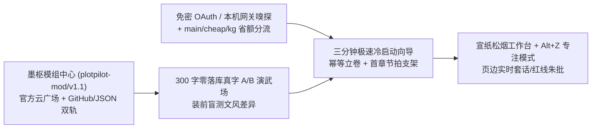

# PlotPilot（墨枢）模组生态与智能模型网关升级全书

**基线对齐版本**：上游主干 `8dba88fa`  
**覆盖范围**：一期（墨枢模组中心、`plotpilot-mod/v1`、宣纸松烟视觉与并发/SSRF 硬化）+ 二期（公开标准 OAuth、本机订阅网关嗅探、三角色省额分流、300 字零落库真字 A/B 演武场、`plotpilot-mod/v1.1`、三分钟幂等冷启动向导、`Alt+Z` 页边朱批）

---

## 一、升级背景与整体产品思路

PlotPilot 原有内核已经具备扎实的长篇状态机（Story Bible、章级摘要链、事件流、故事线 DAG、伏笔账本与十步写作管线）以及 **78 个内置 CPMS 提示词节点**。但在新作者首次上手与进阶创作者深度调优两个关键节点上，仍存在三道现实门槛：

1. **冷启动配置门槛高**：新用户需要先手动准备大模型与向量检索 API Key、理解多类提示词节点与四项写作规则，往往在真正写出第一章前就因配置繁琐而流失；
2. **提示词调优与分享缺乏标准化载体**：78 个内核节点能力极强，但对普通小说/剧本作者而言偏底层工程视角；作者调出一套好用的“去 AI 味滤镜”或“潜台词刀法”后，缺少一套支持**叠加挂载、装前真字盲测、无损卸载还原、既能走 `plotpilot.xyz` 官方云广场又能走 GitHub/JSON 自由分发**的标准模组协议；
3. **长篇连载算力成本高**：十步写作管线包含正文主写、大纲/策略校验、章末摘要与知识图谱三元组抽取。如果全部调用昂贵的旗舰大模型，几十万字连载的 Token 消耗极高；若全部切到廉价小模型，正文文学质感又会明显下降。

围绕上述痛点，本次升级在**不破坏内核原有十步管线、100% 保留并增强 `plotpilot.xyz` 官方书元/社区共享/登录互动能力**的前提下，打通了从**「免填 Key 接通模型 → 三分钟极速立卷 → 模组中心真字 A/B 盲测挂载 → 按角色省额推进正文 → `Alt+Z` 沉浸页边朱批修稿」**的完整创作闭环。



---

## 二、八大核心新增亮点详解

### 1. 双轨制「墨枢模组中心（Mod Hub）」与创作者打包工坊

- **官方云广场与去中心化开源源无缝融合**：在 `/square` 独立展馆页（`SquareView.vue`）与工作台抽屉（`PromptPlaza.vue`）中，完整保留 `plotpilot.xyz` 官方书元、社区共享与全网热榜接口，通过 `cloudPackAdapter.ts` 将云端公开内容自动适配为统一模组卡片；云端离线或未登录时仅作非阻断内联提示，本地精选与离线写作 100% 可用。
- **支持 GitHub 与 JSON 直装**：底部安装栏支持直接粘贴 `github:owner/repo`（支持分支/标签 `@ref` 与子目录自动探测 `plotpilot-mod.json` / `mod.json` / `manifest.json`）、GitHub URL、公网 HTTPS JSON 直链或导入本地 `.json` 文件。
- **六大面向创作者的职能分区与 6 款内置精选包**：按真实创作痛点划分为「文风与去AI味」「题材开局包」「剧情节拍器」「人物声线与潜台词」「毒点审稿官」「世界观营造」，随库内置 6 款离线精选模组（`curatedPacks.ts`）。
- **可视化模组打包工坊（`ModPackBuilderModal.vue`）**：支持勾选任意已调优的 CPMS 内核节点，填写方章单字（`glyph`）、人话摘要、样章对比与 v1.1 扩展规则，一键导出标准 JSON 清单分享至社区或 GitHub。

### 2. `plotpilot-mod/v1` 与向后兼容 `v1.1` 全栈开放流派协议

- **三种非破坏性节点挂载模式（`modProtocol.ts`）**：
  - `append_protocol`（默认推荐）：在原节点 System 提示词尾部追加独立协议块，完整保留原厂 `{context}`、`{outline}` 变量插槽与结构化输出契约，支持多模组叠加与独立卸载；
  - `replace_system`：自动捕获原厂纯净基线快照，替换主体提示词的同时保留其他模组追加层，卸载时字节级还原；
  - `standalone_node`：安装独立自定义节点，写入 128-bit CSPRNG 随机归属令牌（`originToken`），严格区分模组节点与用户手建同名节点。
- **`v1.1` 流派全栈能力扩展（100% 兼容 `v1` 导入）**：新增四项可选字段并实施严格长度、去重与纯文本清洗校验：
  - `openingBeatTemplate`：开篇首章节拍与冲突引子支架，直接赋能冷启动立卷；
  - `reviewRedlines`：商业连载审稿毒点红线清单；
  - `antiAiWordlist`：高频 AI 套话巡检词表；
  - `recommendedModelTier`：模组推荐主力模型档位（如旗舰推理档 `flagship` / 均衡档 `balanced` / 省额轻量档 `economy`）。

### 3. 模组详情「300 字零落库真字 A/B 试写演武场」

- **装前真字盲测（`ModPackDetailModal.vue` + `mod_sandbox_trial_service.py`）**：创作者无需先把模组写进全局配置，在详情弹窗内即可绑定一部现有书目（自动提取书目设定摘要）或输入任意试写引子，实时并发生成「原系统基线」与「挂载本模组后」两栏约 300 字真实正文片段，直观检验模组成色。
- **严格零写库沙箱**：试写过程全程在内存中构造临时提示词副本并调用 `main` 角色模型，绝不写入 `novels`、`chapters` 或 CPMS 提示词数据库表。

### 4. 公开标准 OAuth 免填 Key 授权体系

- **多平台合规授权支持（`llm_oauth_service.py` + `llm_oauth_routes.py`）**：
  - **OpenRouter OAuth PKCE**：免手动复制 API Key，走标准 S256 PKCE 浏览器授权回调换取专属额度密钥；
  - **GitHub Models（RFC 8628 Device Flow）**：生成设备验证码一键跳转授权并轮询激活；
  - **Google Gemini 公开标准 OAuth PKCE**：支持用户配置标准 Google Cloud OAuth Client ID 走公开 PKCE 授权与自动令牌续期（严格遵循官方公开标准，不含任何第三方私有客户端凭证硬编码）。
- **本机独立 `0600` 凭证保险箱（`oauth_credential_store.py`）**：所有 OAuth 访问令牌与刷新令牌独立保存在服务端本地 `data/oauth_credentials.json`（POSIX `0600` 权限，原子临时文件替换写入），与 `data/llm_configs.json` 物理隔离，前端状态查询与配置导出全程零明文泄露。

### 5. 本机订阅网关（Magpie 等）与 CLI 就绪状态一键嗅探

- **零配置发现本机代理网关（`local_gateway_probe.py`）**：针对本机运行 OpenAI 兼容订阅网关（如 `Magpie` 默认 `127.0.0.1:3425/v1` 等回环端口）及常见 AI CLI 工具的场景，AI 控制台与冷启动向导提供「一键嗅探本机订阅网关」，自动探测在线端点、拉取 `/v1/models` 可用模型目录，并智能推荐 `main / cheap / kg` 三角色黄金编组。

### 6. 省额度三角色（`main` / `cheap` / `kg`）算力智能分流

- **按任务认知负荷精准用模（`provider_factory.py` + `trace_context.py` + `EngineMatrixSection.vue`）**：
  - `main`（主笔创作）：承担章节正文撰写、场景精修与真字试写，优先使用文学表现力最强的旗舰模型；
  - `cheap`（轻量编排与审校）：承担结构化辅助校验、常规大纲拆解与高频低复杂度调用；
  - `kg`（知识图谱与记忆抽取）：承担章末三元组抽取、实体索引与后台状态归纳。
- 支持「同源角色编组（同一网关不同模型名）」与「独立端点编组（不同提供商独立 Key/BaseURL）」，未单独配置辅助角色时自动平滑回退至 `main` 主模型，100% 兼容旧版单模型配置。

### 7. 三分钟极速冷启动立卷向导

- **三步走直达首章写作（`ColdStartWizardModal.vue`）**：
  - 第一步：一键嗅探本机网关或验证现有模型连接，确认省额角色编组（同时说明记忆检索具备本地词频兜底，免除首次上手的 Embedding Key 阻碍）；
  - 第二步：点选市场题材分类并勾选心仪的叙事模组（自动安装未装模组并检测模型档位匹配度）；
  - 第三步：自动拼合所选模组的 `openingBeatTemplate` 首章节拍支架，一键幂等立卷并自动完成基础设定变量初始化，直接跳入工作台首章开写。

### 8. 宣纸松烟展馆级 UI 重构与 `Alt+Z` 专注模式页边朱批

- **东方纸墨编辑室美学（`main.css`、`internal-workbench-polish.css`、`App.vue`）**：建立宣纸深黛（亮色 `#f4f4f2` / `#161615`）、纯黑松烟（暗色）、古籍泥金（黑金）三套视觉主题，严格区分无衬线 UI 与衬线正文排印，全量正文对比度 `>= 4.5:1`，去除廉价渐变条与杂乱描边堆砌。
- **`Alt+Z` 专注模式与页边轻批注（`Workbench.vue` + `ZenMarginAnnotations.vue`）**：快捷键 `Alt+Z` 一键收起左右侧栏，展开居中 `820px` 宣纸稿纸；开启「页边批注」后，线性时间扫描当前手稿中命中的已装模组 `antiAiWordlist` 套话与 `reviewRedlines` 红线及护栏告警，点击卡片即可平滑滚动高亮定位至对应自然段。
- **窄屏与移动端抽屉自适应（`StatsSidebar.vue`）**：`<768px` 视口下自动将固定侧栏切换为顶栏汉堡抽屉，书架、模组中心与 AI 控制台在 `375x812` 窄屏下零横向滚动溢出。

---

## 三、核心改动思路与底层安全/并发架构权衡

为了让维护团队合入后长期稳定演进，本次所有跨层改动均遵循以下六条硬性工程准则：

### 1. 提示词非破坏性可逆注入与 Fail-Closed 拓扑守卫

- **为什么不直接改写内核 YAML 或硬编码进 Pipeline？** 直接修改内核默认 YAML 会导致用户难以回滚，且多款模组同时修改同一节点（如 `chapter-generation-main`）时会互相覆盖。
- **实现方案**：`modProtocol.ts` 采用深度为 1 的有限状态单遍扫描器维护 `<!-- [PlotPilot-Mod:<packId>:START:...] -->` 边界注释块，并在模组元数据中持久化基线快照与 `originToken`。任何安装、升级或卸载操作前先跑拓扑完整性校验；若用户手动改坏了边界标记或模组内含非法受保护字面量，引擎立即 Fail-Closed 拒绝覆写并保留原稿，绝不误删用户一字一句。

### 2. 多标签页并发一致性：前端 Web Locks WAL + 后端 SQLite `BEGIN IMMEDIATE` 原子 CAS

- **问题场景**：用户同时开着工作台与 `/square` 模组中心两个标签页，并发点击安装/卸载模组或编辑同一 CPMS 节点。
- **实现方案**：
  - 前端 `modHubStore.ts` + `modWalCommon.ts` 通过浏览器 `Web Locks API` 串行化跨标签页模组事务，并在本地存储维护预写日志（WAL）与版本围栏，崩溃重开后可自动对账清理未决变更；
  - 后端 `prompt_mutation_cas.py` 将提示词节点的增删改收敛至进程锁 + SQLite `BEGIN IMMEDIATE` 写事务内，原子校验 `expected_active_version_id`、`expected_version_count` 与预期正文内容，并发冲突时立即返回 `HTTP 409 Conflict`。

### 3. 冷启动立卷端到端幂等与并发防覆盖（`create_if_absent`）

- **问题场景**：用户在弱网下点击「立卷并试写第一章」发生响应超时后重试，或者多标签页同时恢复冷启动草稿，传统 `POST /novels` 会创建多本重复幽灵书目，或覆盖用户在另一窗口刚修改的 `novel.setup.*` 变量。
- **实现方案**：
  - 前端 `ColdStartWizardModal.vue` 采用按操作 ID 的执行锁（`plotpilot:cold-start-op-exec:<opId>`）与全局恢复槽互斥锁双层协调，持久化确定性 `novelId` 与创建载荷快照，并在每次异步边界核验会话代数（`requestEpoch` / `requestSubmitEpoch`），杜绝跨会话幽灵跳转；
  - 后端 `SqliteNovelRepository.create_if_absent` 与 `init_setup_variables_if_absent` 强制顶层事务所有权校验，使用 `BEGIN IMMEDIATE` + `INSERT ... ON CONFLICT DO NOTHING` 及 `WHERE NOT EXISTS (... AND is_current = 1)` 原子提交：同 ID 同载荷幂等复用；同 ID 异载荷或异 ID 抢占同一 `slug` 严格抛出 `EntityConflictError`（映射为 `HTTP 409`），且绝不覆盖任何已存在的用户当前变量版本。

### 4. 网络边界纵深防御：公网逐跳 IP 钉扎抗 DNS Rebinding + 回环专用直连传输

- **公网远程模组拉取（`mod_manifest_remote.py`）**：仅允许 `HTTPS` 标准 `443` 端口，拦截全部私网/环回/链路本地/保留及 IPv6 映射地址；每次重定向（上限 3 跳）重新解析 DNS 并直接将底层 Socket 钉扎至已校验公网 IP（配合 TLS `sni_hostname` 严格校验证书），外加 `_WireHeaderGuardStream` 原始字节流响应头长度（`64 KiB`）与控制字符守卫、`1 MiB` 响应体上限，彻底免疫 DNS Rebinding 与超大包内存放大。
- **本机订阅网关探测与调用（`loopback_transport.py`）**：严格校验目标主机必须为本机回环地址（`127.0.0.1` / `::1` / `localhost`），强制 `trust_env=False`（绕过系统 `HTTP_PROXY` 劫持）且禁止跨主机重定向，确保本机网关流量永不外泄。

### 5. 凭证全生命周期隔离与对抗级错误擦除器

- **存储与导出隔离**：OAuth 令牌仅落盘于 `0600` 权限的 `data/oauth_credentials.json`，配置导出快照与 `/api/v1/llm-control` 响应仅返回布尔状态与脱敏掩码。
- **线性时间多层解码擦除器（`mod_sandbox_routes.py`）**：针对第三方网关在报错消息中可能夹带原始请求头或编码后 Key 的风险，构建固定预算、线性时间的归一化扫描器（覆盖 URL 编码、JSON 转义、Base64/Base64URL、Hex 及常见 `sk-` / `Bearer` / `gho_` / `ya29.` / Query Token 模式），一旦命中可疑凭证片段即替换为安全通用文案。

### 6. DDD 分层架构零违规守门

- 新增代码严格遵守 `domain`（零外部依赖）← `application`（纯用例与端口编排）← `interfaces`（FastAPI 路由、DTO 与安全守卫）以及 `infrastructure`（SQLite、OAuth 文件仓、HTTP 传输、Provider 实现）的分层依赖方向，并由 `tests/unit/interfaces/api/test_architecture_boundaries.py` 自动扫描 AST 导入边持续门禁。

---

## 四、全量改动与新增文件全景索引（相对 `8dba88fa` 共 79 个文件）

### 1. 后端领域层与应用层（`domain/` · `application/`）

| 状态 | 文件路径 | 核心职责说明 |
| --- | --- | --- |
| `M` | `domain/ai/services/llm_service.py` | 扩展角色感知 LLM 调用契约 |
| `M` | `domain/ai/value_objects/prompt.py` | 提示词值对象能力补强 |
| `M` | `domain/shared/exceptions.py` | 新增 `EntityConflictError` 领域冲突异常（映射 HTTP 409） |
| `M` | `application/ai/llm_control_service.py` | 整合三角色路由配置、OAuth 凭证注入与 CPMS 管理 |
| `A` | `application/ai/llm_oauth_service.py` | OpenRouter PKCE、GitHub Device Flow、Google Gemini 公开标准 OAuth 编排服务 |
| `A` | `application/ai/local_gateway_probe.py` | 本机 Magpie 等订阅网关 `/v1/models` 探测、角色推荐与 CLI 就绪巡检 |
| `A` | `application/ai/mod_sandbox_trial_service.py` | 300 字零落库真字 A/B 试写沙箱双路对比用例服务 |
| `M` | `application/ai/trace_context.py` | 基于 `ContextVar` 传递当前调用链角色（`main` / `cheap` / `kg`） |
| `M` | `application/core/services/novel_service.py` | 集成原子幂等建书（`create_if_absent`）与首章前置变量无覆盖初始化 |
| `M` | `application/engine/dag/registry.py` | DAG 节点与辅助调用角色标注对接 |

### 2. 后端基础设施层与接口层（`infrastructure/` · `interfaces/`）

| 状态 | 文件路径 | 核心职责说明 |
| --- | --- | --- |
| `M` | `infrastructure/ai/config/settings.py` | 扩展三角色模型配置结构与公开 OAuth 客户端配置项 |
| `M` | `infrastructure/ai/llm_environment.py` | 运行时环境变量、OAuth 令牌与多角色回退解析 |
| `A` | `infrastructure/ai/loopback_transport.py` | 本机回环网关安全直连传输层（禁系统代理、禁跨源重定向） |
| `A` | `infrastructure/ai/oauth_credential_store.py` | `0600` 权限原子落盘的本地 OAuth 凭证存储仓 |
| `M` | `infrastructure/ai/prompt_gateway.py` | 提示词网关与角色上下文协同 |
| `M` | `infrastructure/ai/prompt_manager.py` | CPMS 提示词节点管理与版本追踪增强 |
| `M` | `infrastructure/ai/prompt_registry.py` | 内置 78 个 CPMS 节点注册表元数据对齐 |
| `M` | `infrastructure/ai/provider_factory.py` | 支持 `main / cheap / kg` 分角色实例池、OAuth 动态令牌与回环网关分发 |
| `M` | `infrastructure/ai/providers/openai_provider.py` | 支持本机回环传输层与无 Key 本机订阅网关兼容 |
| `M` | `infrastructure/ai/providers/anthropic_provider.py` | Provider 角色与异常边界对齐 |
| `M` | `infrastructure/ai/providers/gemini_provider.py` | 支持 Google OAuth Bearer Token 与标准 API Key 双模式鉴权 |
| `M` | `infrastructure/persistence/database/connection.py` | SQLite 连接与顶层事务状态辅助支持 |
| `M` | `infrastructure/persistence/database/schema.sql` | 数据库结构与唯一约束对齐 |
| `M` | `infrastructure/persistence/database/sqlite_novel_repository.py` | 实现顶层 `BEGIN IMMEDIATE` 原子幂等 `create_if_absent` 与 `init_setup_variables_if_absent` |
| `M` | `infrastructure/persistence/in_memory_novel_repository.py` | 内存仓储与 SQLite 仓储严格的幂等/409 冲突行为一致性对齐 |
| `M` | `interfaces/api/routes.py` | 注册新增 OAuth、网关嗅探与模组演武场路由 |
| `M` | `interfaces/api/v1/core/novels.py` | 建书接口支持原子幂等语义并将 `EntityConflictError` 映射为 HTTP 409 |
| `M` | `interfaces/api/v1/core/settings.py` | 全局设置接口同步更新 |
| `M` | `interfaces/api/v1/workbench/llm_control.py` | AI 控制台配置读写、角色路由与 CPMS 原子 CAS 接入 |
| `A` | `interfaces/api/v1/workbench/llm_oauth_routes.py` | OAuth 授权发起/回调/轮询/解绑与本机订阅网关嗅探 REST 端点 |
| `A` | `interfaces/api/v1/workbench/mod_manifest_remote.py` | 远程 GitHub/HTTPS 模组安全拉取端点（逐跳 IP 钉扎抗 DNS Rebinding） |
| `A` | `interfaces/api/v1/workbench/mod_sandbox_routes.py` | 模组 300 字真字 A/B 试写端点与线性时间对抗级凭证擦除器 |
| `A` | `interfaces/api/v1/workbench/prompt_mutation_cas.py` | CPMS 提示词变更 SQLite `BEGIN IMMEDIATE` 原子 CAS 事务守卫 |

### 3. 前端协议层、状态管理与界面组件（`frontend/`）

| 状态 | 文件路径 | 核心职责说明 |
| --- | --- | --- |
| `A` | `frontend/src/domain/modPack/types.ts` | `plotpilot-mod/v1` 与 `v1.1` 清单、节点覆写、模型档位等核心类型定义 |
| `A` | `frontend/src/domain/modPack/modProtocol.ts` | 单遍有限状态协议块解析器、v1/v1.1 双向校验清洗与 Fail-Closed 合成引擎 |
| `A` | `frontend/src/domain/modPack/curatedPacks.ts` | 内置 6 款精选叙事模组（含完整 `v1.1` 开篇支架、审稿红线与去套话词表） |
| `A` | `frontend/src/domain/modPack/cloudPackAdapter.ts` | `plotpilot.xyz` 云端书元与社区共享目录向标准 `NarrativeModPack` 的无损适配器 |
| `A` | `frontend/src/domain/modPack/modWalCommon.ts` | 跨标签页模组预写日志（WAL）数据结构与版本围栏工具 |
| `A` | `frontend/src/domain/modPack/modUninstallEngine.ts` | 模组无损卸载、基线还原与 `originToken` 血统核验引擎 |
| `A` | `frontend/src/stores/modHubStore.ts` | 基于 `Web Locks API` 的跨标签页模组安装、升级、卸载与持久化状态仓 |
| `A` | `frontend/src/components/modhub/ModPackCard.vue` | 宣纸方章风格模组展馆卡片组件 |
| `A` | `frontend/src/components/modhub/ModPackDetailModal.vue` | 模组详情检视弹窗（集成 v1.1 规则展示与 **300 字真字 A/B 试写演武场**） |
| `A` | `frontend/src/components/modhub/ModPackBuilderModal.vue` | 可视化创作者模组打包与 JSON 导出工坊 |
| `A` | `frontend/src/components/onboarding/ColdStartWizardModal.vue` | 三分钟极速冷启动立卷向导（含双层 Web Locks 对账与会话代数隔离） |
| `A` | `frontend/src/components/workbench/ZenMarginAnnotations.vue` | `Alt+Z` 专注模式宣纸页边轻批注抽屉（套话/红线实时扫描与段落滚动定位） |
| `M` | `frontend/src/views/Home.vue` | 宣纸书架首页、冷启动向导入口、未完草稿恢复横幅与删书锁协同 |
| `M` | `frontend/src/views/SquareView.vue` | `/square` 独立墨枢模组中心展馆页（融合云广场与 GitHub/JSON 去中心化安装） |
| `M` | `frontend/src/views/Workbench.vue` | 工作台 `Alt+Z` 沉浸专注模式、页边批注联动与双栏分割布局稳态兜底 |
| `M` | `frontend/src/components/workbench/WorkArea.vue` | 宣纸居中写作区、实时手稿快照同步与批注段落平滑定位支持 |
| `M` | `frontend/src/components/workbench/PromptPlaza.vue` | 四大视图模组广场（发现 / 已安装 / 78 内置内核 / 反 AI 质检） |
| `M` | `frontend/src/components/workbench/LLMControlPanel.vue` | AI 控制台集成公开 OAuth、本机网关一键嗅探与省额三角色分流配置 |
| `M` | `frontend/src/components/settings/sections/EngineMatrixSection.vue` | 设置中心模型引擎矩阵（集成网关探测与角色编组） |
| `M` | `frontend/src/components/settings/sections/EngineMatrixEndpointGrid.vue` | 多角色独立端点配置网格 |
| `M` | `frontend/src/api/llmControl.ts` | 新增 OAuth、本机网关探测、远程模组拉取、A/B 试写与原子 CAS 前端 API 客户端 |
| `M` | `frontend/src/assets/styles/main.css`、`internal-workbench-polish.css`、`App.vue` 等 14 个 UI/入口文件 | 东方宣纸松烟三主题体系、排版层级统一、顶栏/侧栏模组入口与窄屏抽屉适配 |

### 4. 新增与增强单元测试矩阵（`tests/`，共 130 项专项单测）

| 状态 | 测试文件路径 | 验证重点 |
| --- | --- | --- |
| `A` | `tests/unit/test_mod_hub_remote.py` | 远程模组拉取协议白名单、私网拦截、逐跳 DNS 重解析 IP 钉扎、CRLF 头注入拦截 |
| `A` | `tests/unit/test_prompt_mutation_cas.py` | CPMS 提示词新建/更新/删除 `BEGIN IMMEDIATE` 原子 CAS 与 409 并发冲突 |
| `A` | `tests/unit/application/ai/test_llm_oauth_and_gateway.py` | OpenRouter/GitHub/Google OAuth 状态机、`0600` 凭证隔离、本机网关与回环直连探测 |
| `A` | `tests/unit/infrastructure/ai/test_llm_role_routing.py` | `main / cheap / kg` 三角色独立分发、同源覆盖与未配置角色安全回退 |
| `A` | `tests/unit/application/ai/test_mod_sandbox_trial_service.py` | 300 字真字 A/B 演武场双路并发生成与 SQLite 零落库严格隔离断言 |
| `A` | `tests/unit/interfaces/api/test_mod_sandbox_scrubber.py` | 线性时间多层编码（URL/Base64/Hex/JSON）凭证脱敏擦除器对抗测试 |
| `A` | `tests/unit/application/core/test_novel_create_idempotency.py` | 建书全列快照幂等、同 ID 异参 409、异 ID 同 `slug` 409、并发用户变量防覆盖 |
| `M` | `tests/unit/interfaces/api/test_architecture_boundaries.py` | 全仓 DDD 四层依赖边界 AST 静态扫描零违规验证 |

---

## 五、创始人快速合入与本地验证指南

交付包同时提供了**完整可直接运行的源码目录（含预编译 `frontend/dist`）**与**基于上游 `8dba88fa` 的标准 Git 补丁 / Bundle 包**，维护组可任选最顺手的方式审阅或合入：

### 方式 A：使用 Git Bundle 无损拉取完整提交历史（推荐）

在官方 `PlotPilot` 本地仓库（含 `8dba88fa` 提交）根目录下执行：

```bash
# 1. 从离线 bundle 拉取升级分支（不污染当前工作分支）
git fetch ./patches/plotpilot-upgrade.bundle master:feat/modhub-and-gateway-v1.1

# 2. 检视分阶段提交历史与文件变更统计
git log --oneline 8dba88fa..feat/modhub-and-gateway-v1.1
git diff --stat 8dba88fa..feat/modhub-and-gateway-v1.1

# 3. 审阅通过后合并至主干
git checkout master
git merge feat/modhub-and-gateway-v1.1
```

### 方式 B：使用 `git am` 按演进阶段逐笔合入，或 `git apply` 一键单补丁合入

```bash
# 逐阶段合入（共 5 笔清晰提交：一期模组中心 -> 二期A网关/OAuth -> 二期B演武场 -> 二期C冷启动/页边批注 -> 文档与过渡收口）
git am --3way ./patches/series/*.patch

# 或者直接将全部改动作为单次补丁应用至工作区
git apply --index ./patches/plotpilot-all-in-one-from-8dba88fa.patch
```

### 方式 C：直接解压 `source/` 目录本地运行体验

`source/` 目录已预先完成 `frontend/dist` 生产静态资源编译（不含任何个人 `.env`、数据库或缓存）：

```bash
cd source
uvicorn interfaces.main:app --host 127.0.0.1 --port 8005
# 浏览器直接打开 http://127.0.0.1:8005 即可体验完整新版工作台与模组中心
```

### 自动化测试与构建复核命令

```bash
# 1. 后端一期 + 二期全量专项单元测试（130 passed）
pytest \
  tests/unit/test_mod_hub_remote.py \
  tests/unit/test_prompt_mutation_cas.py \
  tests/unit/application/ai/test_llm_oauth_and_gateway.py \
  tests/unit/infrastructure/ai/test_llm_role_routing.py \
  tests/unit/interfaces/api/test_architecture_boundaries.py \
  tests/unit/application/ai/test_mod_sandbox_trial_service.py \
  tests/unit/interfaces/api/test_mod_sandbox_scrubber.py \
  tests/unit/application/core/test_novel_create_idempotency.py \
  -v

# 2. 前端类型检查与生产构建
cd frontend
npx vue-tsc -b && npx vite build
```
