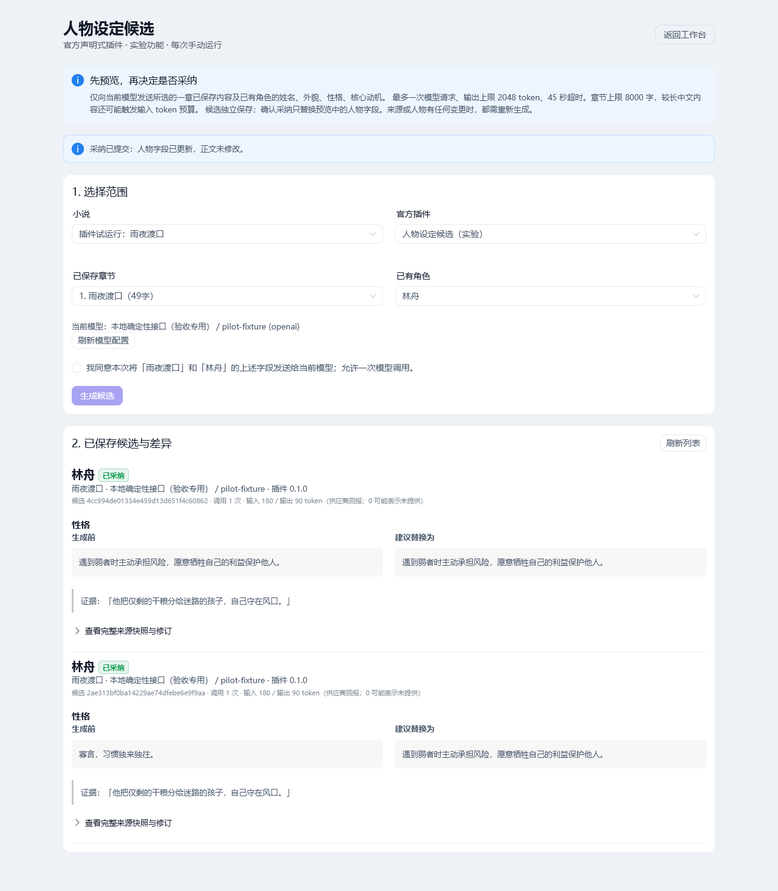

# Official declarative character candidate pilot

Reviewable manual vertical slice, host API **0.1**, artifact type
**character_card_patch@1**. This is a controlled official-package executor, not a
sandbox. The existing novel pipeline, cloud connector and provider configuration
remain available. There is no call to `run_chapter`, no plugin daemon, no paid
model required by tests, no package installer, eval, script or dynamic HTML.

## Run and inspect

Use a disposable data directory, not an author's real work. Prepare dependencies
using the repository's normal requirements and frontend lockfile. From repo root:

```powershell
$env:PLOTPILOT_PROD_DATA_DIR = '<absolute disposable directory>'
$env:DISABLE_AUTO_DAEMON = '1'
.venv/Scripts/python.exe -m uvicorn interfaces.main:app --host 127.0.0.1 --port 8005
# In another terminal, frontend directory:
npm.cmd run dev
```

`DISABLE_AUTO_DAEMON=1` is required for review to prevent unrelated automatic
model consumption. Configure an existing model profile in the workbench, or use
an OpenAI-compatible local mock with a dummy key, an explicit fake model name,
`use_legacy_chat_completions=true`, and no extra body/query overrides. The pilot
does not create or copy keys. It refuses missing model/key configuration instead
of silently returning a mock result. Tests inject a fake LLMService explicitly.

Create/select a disposable novel with one saved chapter and an existing character.
Open its workbench and click **人物候选（实验）**, or open
`/plugins/character-candidates?project=<novel slug or ID>`. Choose one chapter and
one canonical character, inspect the active model identity, and explicitly consent
to this one call. Candidate output appears in the persistent list, with complete
field replacements, exact source quotes, model/plugin metadata and source snapshot.
The separate **确认采纳** action needs its own checkbox. Refresh the page to verify
candidate persistence. Edit source/target through an old entry point and confirm
adoption rejects it with a request to generate again.

API contract and endpoint list: [plugin-pilot-contract.md](plugin-pilot-contract.md).



## Implementation map

- `application/plugin_pilot/__init__.py`, `contracts.py`, `loader.py`, `service.py`:
  host schema and limits, fixed-directory package validation and finite executor.
- `application/engine/services/persistence_queue.py`: bounded acknowledged local
  command lane, preserving legacy queue behavior and handler registration.
- `infrastructure/ai/plugin_pilot_model.py`: active profile identity, existing
  factory/provider reuse, explicit small config and real HTTP request budget.
- `infrastructure/persistence/database/plugin_pilot_store.py`: writer-only
  snapshots, candidate storage, trigger verification and atomic adoption/result.
- `infrastructure/persistence/database/migrations/z_plugin_pilot_v1.sql`: additive
  revision/tombstone sidecar, six triggers and candidate/command/adoption tables.
- `interfaces/api/v1/plugin_pilot.py`, `interfaces/api/routes.py`: manual pilot API
  and additive registration alongside the existing cloud connector.
- `frontend/src/api/pluginPilot.ts`, `frontend/src/views/CharacterCandidates.vue`,
  `frontend/src/router/index.ts`, `frontend/src/components/stats/StatsTopBar.vue`:
  typed client, scope/consent/preview/adoption/recovery UI and discoverable entry.
- `official-plugins/character-candidate/manifest.json`, `prompt.txt`: actual
  declarative official package and template.
- `tests/integration/test_plugin_pilot.py`: 42 meaningful SQLite/API/LLM-boundary,
  legacy-path, conflict, rollback, recovery and manifest cases.
- `tests/unit/application/snapshot/services/test_snapshot_service_engine_state.py`:
  align its hand-built chapter fixture with the production compound unique key;
  assert foreign-key checking stays enabled.
- `.github/workflows/backend-ci.yml`: targeted pilot integration CI and trigger
  paths for official package/SQL migration changes.
- `docs/plugin-pilot-contract.md`, `docs/plugin-pilot-review.md`: API contract,
  installation, constraints, developer verification and rollback notes.

## Scope and data

- Fixed repository-owned `official-plugins/*/manifest.json` + local `prompt.txt`.
  Host compatibility is exactly `0.1`, package versions are `0.x.y`; actions and
  their sequence are whitelisted. Path escapes, oversized files, duplicates,
  incompatible contracts and unknown keys are rejected. No user import route.
- Executor dispatches actions, never plugin IDs. A second official package using
  the same supported contract can use the same executor without new business code.
- Input: one saved chapter (max 8000 characters, further limited by the token
  budget) and canonical character ID/name/appearance/personality/core_motivation.
  The host retains revisions/IDs as evidence. Other chapters, hidden profiles,
  worldbuilding and real user credentials are not included in prompts.
- Output: strict host schema, only `appearance`, `personality`, `core_motivation`
  strings, 1–600 characters per field, 1–3 fields, 1–6 exact chapter quotes of
  1–400 characters, every changed field covered. No arbitrary field paths or SQL.
  Evidence proves textual provenance, not that a literary inference is correct.
- Limits: one host model invocation and one actual provider HTTP request, 16000
  input token budget, 2048 output token cap, 12000 output bytes, 45-second timeout.
  Input uses conservative UTF-8 byte count plus a 1024 protocol reserve; usage
  returned by the provider is checked too. Zero usage means unreported, not free.
  This is intentionally more restrictive for Chinese/large character cards.
- A pilot-specific `GenerationConfig` preserves small caps without changing the
  legacy engine's 120000-token minimum. A request hook rechecks the actual HTTP
  body, blocks streaming and every retry/fallback after the first HTTP request;
  SDK retries are disabled. Profile extra body/query overrides are rejected.
  Providers that need fallback must use an explicitly compatible profile.
- Consent binds the resolved active model profile hash, including configuration
  changes; hashes and identity metadata expose no keys. No automatic model retry.

## Persistence, concurrency and transaction boundary

Migration `z_plugin_pilot_v1.sql` is additive: revision sidecar, six table triggers,
candidate, command-result and adoption tables. Source of truth is
`unified_characters`, never `bible_characters`. Triggers cover INSERT, UPDATE,
DELETE on both authoritative tables, including `SqliteChapterRepository.save`
upsert, Bible delete/reinsert, raw legacy updates, replacements, deletion and ABA.
Random revision tokens change even on semantically identical writes. Tombstones
have no cascading FK, and insert triggers replace the retained token, so an ID
recreated after deletion cannot inherit an old candidate's revision. Database
backups must retain sidecar and triggers. Whole-file historical restoration is
outside concurrent editing guarantees; restore the whole database consistently.

Before snapshots and adoption, the host compares all six installed trigger bodies
with its shipped migration, and requires source/target revision entries. Missing
or altered coverage disables adoption. Sources and target must still belong to the
same existing project. **Any** source/target write, including timestamp-only or
identical re-save, rejects adoption; there is no source-reconfirmation UX. Generate
a new candidate from current state. Other project/character writes do not conflict.

The existing PersistenceQueue has a local, bounded (32 outstanding) acknowledged
command lane. It runs the handler on the real registered SQLite writer and returns
its actual result through a future. Async waiting never blocks the event loop.
It does not reinterpret the old placeholder cursor's rowcount. The pilot sends
typed actions, not arbitrary SQL, through this lane. Internal SQL remains solely in
the host store implementation.

Adoption opens `BEGIN IMMEDIATE`, reads candidate and current source/target, checks
revisions and snapshot equality, executes a conditional canonical character update,
checks real `cursor.rowcount == 1`, records adoption and its new revision, marks
candidate adopted, and writes the durable command result before committing. A
savepoint rolls back character, revision and adoption relation together on failure;
the conflict/failed command outcome is then recorded in the same outer transaction.
Unexpected outer transaction/commit failure returns no success.

`command_id` is globally unique and bound to project/candidate/confirmation hash.
An exact replay returns the stored result; a changed payload is rejected. A
candidate cannot be adopted twice, even with a new ID. Writer timeout returns
`pending`, not success. Query the same command; frontend persists that ID before
POST and queries on failure/reload. `unknown` can mean not submitted, still queued,
or lost in a process crash; it never proves failure. After querying `unknown`, the
UI offers an explicit manual retry using the identical command ID, candidate ID,
project and original confirmed payload. It never automatically retries or replaces
the command ID; the writer's idempotency handles duplicate delivery safely.
Candidate storage uses an acknowledged commit too; if its response is lost, refresh
the list before generating again. This pilot has no durable generation task queue.

## Verification commands

```powershell
.venv/Scripts/python.exe -m pytest tests/integration/test_plugin_pilot.py -q
.venv/Scripts/python.exe -m pytest tests/unit/application/engine/test_persistence_queue.py tests/unit/application/engine/test_persistence_queue_v2.py tests/unit/infrastructure/persistence/database/test_migration_runner.py tests/unit/infrastructure/persistence/database/test_write_dispatch_startup_bypass.py tests/unit/interfaces/api/v1/test_cloud_routes.py -q
# frontend:
npm.cmd run build
```

The pilot suite uses real temporary SQLite databases, shipped migrations and actual
PersistenceConsumer threads. Fake inference has no dependency on real credentials.
It covers API through persisted diff/adoption, cross-project rejection, schema and
budgets, legacy repository saves, ABA, atomic fault rollback, durable idempotency,
late commits after timeout, manifest refusal and actual OpenAI provider HTTP cap
despite the legacy profile minimum. Backend CI runs this one integration module
before its existing unit-test step. It deliberately does not run all integration
tests. Official package and SQL migration changes also trigger that workflow.

### Verification results (2026-11-01)

- Python static compilation: passed for the new host, model adapter, store, router
  and test module. Official manifest loads; all six expected trigger contracts read.
- Final combined targeted suite: **78 passed**, 68 legacy datetime warnings,
  31.69 s, including **42 pilot cases and 36 existing regression cases**. Exact
  command from repository root:

```powershell
.venv/Scripts/python.exe -m pytest tests/integration/test_plugin_pilot.py tests/unit/application/engine/test_persistence_queue.py tests/unit/application/engine/test_persistence_queue_v2.py tests/unit/infrastructure/persistence/database/test_migration_runner.py tests/unit/infrastructure/persistence/database/test_write_dispatch_startup_bypass.py tests/unit/interfaces/api/v1/test_cloud_routes.py tests/integration/infrastructure/persistence/database/test_sqlite_chapter_delete_renumber.py tests/integration/interfaces/api/v1/test_bible_api.py tests/integration/interfaces/api/v1/test_bible_extended_api.py -q --tb=short --maxfail=3 -p no:cacheprovider --basetemp=.venv/pilot-pytest-run-02
```

- Frontend `npm.cmd run build`: final vue-tsc and Vite build passed, including the
  unknown-command manual-retry UI.
- Browser acceptance used the real Vue page, FastAPI application, persistence
  consumer and OpenAI provider against a local deterministic HTTP model endpoint.
  Generation left the original character unchanged; preview displayed the field
  diff and exact quote; manual adoption changed only the selected character field;
  reloading retained the adopted candidate. SQLite independently confirmed this.
- An intercepted adoption POST reproduced the unsent-request case. Query returned
  `unknown`; explicit retry reused the same command ID and committed once. The
  browser's single network error was deliberately injected for this check.
- The local endpoint observed `max_tokens: 2048` and one HTTP request per run.
  This validates transport/integration, not real-model literary quality. Responses,
  Anthropic and Gemini end-to-end acceptance remains unverified.
- `git diff --check`: passed (existing generated bundle CRLF notices only).
- First pytest attempt using the default Windows temp directory could not create
  fixtures because that old directory's ACL denied access. No test failure was
  treated as a pass; the valid reruns used new isolated temp directories above.
- Initial full unit run: 1498 passed, 13 failed, 7 skipped, 11 errors. An isolated
  `c2f6888` baseline with the same dependencies had 1499 passed, 12 failed,
  7 skipped, 11 errors. The sole extra failure was a hand-built snapshot test
  fixture missing the production `UNIQUE(novel_id, number)` constraint referenced
  by `chapter_reviews`; the new trigger exposed this existing schema mismatch.
  The fixture now matches production, explicitly keeps foreign keys enabled,
  and its complete test module passes all 8 cases. Production constraints were
  not relaxed. Final full unit rerun: **1499 passed, 12 failed, 7 skipped,
  11 errors**; the failing/error test-ID set exactly matches the baseline.
- The remaining baseline failures include prompt/variable-contract assertions,
  dependency/API assumptions and Anthropic SDK `httpx2` incompatibility with
  the repository's `httpx` clients. This PR does not claim all tests passed.
- The feature branch also includes upstream `f59e309` (README/contributor
  governance documentation only); the baseline code under test is unchanged.

Windows review caveats in the inspected baseline: the existing startup
`cleanup_orphans` can terminate same-path Python processes, including a local mock
or venv launcher. Windows browser testing used an external launcher that disabled
only that cleanup callback while retaining the real application/lifecycle. Normal
Windows startup retains this upstream limitation; this pilot does not repair it.
An existing migration can also warn
about a missing `macro_diagnosis_results` table. Report these separately from pilot
test failures. If an older Windows pytest temp/cache directory has incompatible
ACLs, use a new disposable `--basetemp=.venv/pilot-pytest-<unique-run>` and
`-p no:cacheprovider`; do not change ACLs or delete someone else's temp directory.

## Tradeoffs, limitations and rollback

Single-process local manual pilot; one generation at a time. There is no multiuser
authorization boundary beyond existing local application conventions, no plugin
installation lifecycle, cancellation/upgrade/revocation platform, price accounting,
external contributor SDK guarantee or distributed job system. List shows the latest
100 candidates per project. Provider usage and exact literary correctness remain
external. Timeout cannot prove an upstream request stopped consuming tokens.

Candidates include chapter text and model output in the local database; treat its
backups with the same privacy expectations as the manuscript. The pilot stores no
model keys in candidates. It never updates manuscript content. Only human-confirmed
adoption updates the three allowed canonical character fields.

Before enabling on meaningful data, back up the whole SQLite database (including WAL
via the normal safe backup process). To roll back the code, remove its API router
registration and workbench link/route, then revert the pilot code changes. Existing
novel/chapter tables were not altered. Dormant pilot tables and triggers can remain
for rollback safety; remove them only with the app stopped and a verified backup,
using a separately reviewed migration. Removing revision triggers disables the pilot
rather than allowing unprotected adoption. To undo an accepted content change, use
the stored before-values with deliberate author review; code rollback does not
silently revert confirmed character edits.
